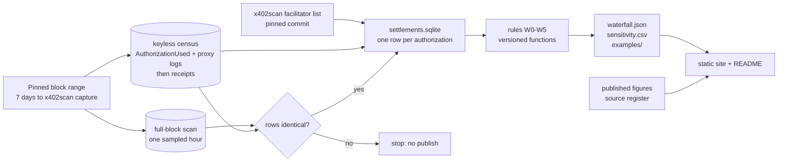
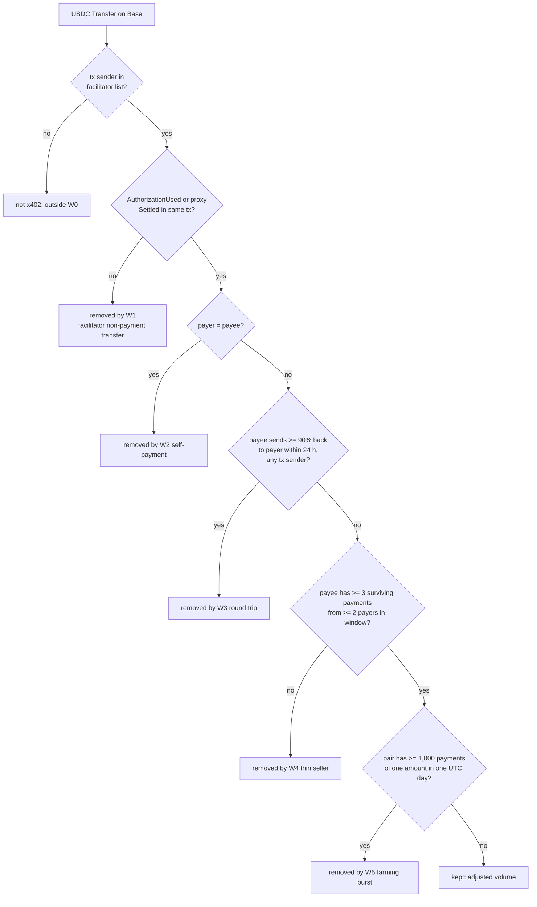
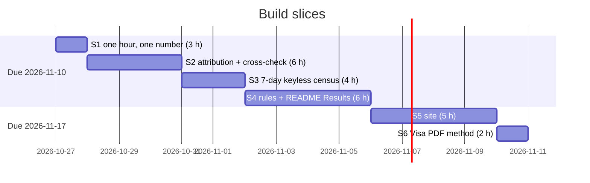

# x402 ground truth

**One sentence.** A payments analyst at Coinbase or Circle can see how much of x402's reported Base volume survives each named exclusion rule, so that they can quote an adoption number with its method attached.
**Owner.** Rahil Bhavan
**Date.** 2026-10-27
**Status.** DRAFT
**Path.** `docs/prd.md` in `~/projects/x402-ground-truth` (local; no remote yet)

---

## 1. Who it is for

**Role.** A product, BD or data analyst on an agent-payments team (Coinbase Developer Platform's x402 team, Circle's USDC payments team) who has to put an x402 adoption number in a deck or a post. The secondary reader is a crypto journalist or researcher who quotes x402 numbers.
**How many.** Day one: about 10 readers (Rahil, the reviewers he chooses, and the recruiters who open the repo).
**Where they are.** At a desk, comparing a dashboard number with a number from an X thread.
**What they already have.** A browser, a Basescan account at most, no node or paid data plan.

## 2. Today, without this

The analyst picks one of these figures and quotes it: x402scan's live total, the Visa/Artemis "adjusted" figure, an X thread's 30-day number, or a news summary's payment count. The published figures disagree by about two orders of magnitude, but they cover different windows and chains (see Facts), so nobody can tell how much of the gap is method. x402scan publishes its counting filter as code, but no exclusion rules. The adjusted figures (Visa/Artemis, Artemis) publish no code. The analyst cannot rerun any adjusted figure on the same blocks.

## 3. Must do

1. Read every x402 "exact"-scheme USDC settlement on Base inside one fixed block range from public chain data.
2. Attribute each settlement to a facilitator from a versioned, cited address list.
3. Apply each exclusion rule as a separate, named and versioned function, and report how much volume and how many payments each one removes, in order.
4. Show each published figure next to this project's number for the same window, with that figure's definition and date.
5. Publish the settlement table, rule outputs and a single rerun command that reproduces every published number from the pinned block range.
6. Give five example transactions for each rule, each linked to Basescan, so a reader can check the rule by hand.

## 4. Non-goals

- No live or real-time dashboard. One pinned window, rerun on demand. x402scan already does live totals.
- No list of wallets accused of wash trading. Rules describe patterns, and examples show transactions, not named people or companies.
- No chains other than Base in v1. Solana x402 traffic waits for a separate version.
- No payment product, facilitator or spend-policy layer. That was idea #1+#6 and is a separate project.
- No change to `x402-exception-desk`. It gets one README link after this ships.
- No MPP/Tempo pipeline unless slice 1 shows its data can be read for free in under one day of work (cut list item 1).

## 5. Assumed decisions

- `ASSUMED 2026-10-27` A new repo, not a module inside `x402-exception-desk`. Rules out one combined repo, because that repo is a finished v1.1 release that answers a different question with synthetic data.
- `ASSUMED 2026-10-27` The project site reuses `x402-exception-desk`'s visual system (ink `#15202b`, accent `#1652f0`, system UI type), and X cards use `rahil-design`. Rules out a new look for this site.
- `ASSUMED 2026-10-27` The window is the 7 days ending at the moment x402scan's rolling 7-day Base figure is captured (first capture in slice 1), on Base only. Rules out a 30-day or all-time headline in v1, because x402scan offers no historical per-day figure to check against and 30 days does not fit the hours.

## 6. Open questions

1. May the rule example pages show payer and payee addresses (public onchain data), or only transaction hashes? Asked of: Rahil. Waiting on it: the rules page in slice 5. The default until answered is hashes only.
2. Optional speed-up: a free CDP API key or a Google Cloud project for BigQuery's public Base dataset (both account actions) would replace the overnight keyless pull. Asked of: Rahil. Waiting on it: nothing; every slice runs keyless.
3. Creating the public GitHub repo, the GitHub Pages site and any X post are Rahil's actions. Waiting on it: publication only. All building happens locally.

## 7. Constraints

**Deadline.** 2026-11-10 for slices S1–S4 and the README Results; the site (S5) follows by 2026-11-17. Two weeks, because the scan's "why now" (agent-payment numbers being argued this week) loses value as the argument moves on. The Cantina v4lend contest ends 2026-11-03 and competes for the same hours.
**Must use.** Python 3.12 standard library plus SQLite, matching `x402-exception-desk`. Only free, keyless or free-tier public data.
**Must not touch.** `x402-exception-desk`, any wallet or key, any paid API.
**People.** Rahil, about 10 hours a week, with agents: about 20 hours to 2026-11-10, fewer in the Cantina week. Slices are estimated in hours to fit that.
**Legal or policy.** Public onchain data only. No claim that a named person or company committed fraud.

## 8. Facts this rests on

| Fact | Source | Used for |
| --- | --- | --- |
| x402 "exact" on EVM settles through EIP-3009 `transferWithAuthorization`, a Permit2 proxy or ERC-7710. The facilitator submits and pays gas. | B2 | W1's marker list. ERC-7710 is counted in slice 2 and noted if nonzero. |
| The deployed proxies emit `Settled()` / `SettledWithPermit()`, not the spec's `x402PermitTransfer`. Base addresses: exact `0x402085c248EeA27D92E8b30b2C58ed07f9E20001`, upto `0x4020A4f3b7b90ccA423B9fabCc0CE57C6C240002`, batch settlement `0x4020074e9dF2ce1deE5A9C1b5c3f541D02a10003`. Over about 22 hours they logged 5, 4,495 and 617 events. | R1 | W1 counts all three as x402 settlement, shown as separate scheme rows. Removing them as non-payments was the draft's largest error. |
| EIP-3009 emits `AuthorizationUsed` plus `Transfer`; any EIP-3009 user emits it, not only x402. | B3, B7, B8 | Settlement = `AuthorizationUsed` in a facilitator-sent transaction, not every `AuthorizationUsed`. |
| v2 adds `upto` and `batch-settlement`, so one transaction can carry several payments. | B5 | Count payments per authorization, not per transaction (AC-11). |
| Base USDC is `0x833589fCD6eDb6E08f4c7C32D4f71b54bdA02913`, 6 decimals. Not yet checked against Circle's docs. | B6 | Slice 1 confirms it by reading `decimals()` and `symbol()` from the contract. |
| x402scan counts every USDC `Transfer` in a transaction whose sender is a listed facilitator, with no further filter. Since 2026-06-09 its Base data comes from Bitquery; the CDP syncer is disabled. Main was at commit `5732bb83` on 2026-10-27. | C5, C6, C7, R4 | W0 reproduces the filter. A CDP-versus-Bitquery row difference is a reconciliation item, not a replication failure. |
| x402scan's API costs $0.01 per call and offers only rolling 1, 7, 14 and 30-day lookbacks from now, with no per-UTC-day history. | R2 | AC-4 compares against a rolling 7-day figure captured from the free web page, with its timestamp. The paid API is not used. |
| x402scan's facilitator registry lists 30 facilitators with Base addresses: Coinbase 40 (22 deprecated), PayAI 15. | C2, C3, C4 | The attribution list, pinned at one x402scan commit. |
| Visa/Artemis ("Agentic Payments from the Ground Up", July 2026, data to 2026-04-21): raw about $135.7M and 178.3M transactions, adjusted about $15.0M and 109.6M. The "$19M" figure appears in one article only. | A1, A2, D2 | The reconciliation table. Quote $15.0M, dated, not $19M. |
| The Visa/Artemis seller rule as relayed: a seller needs at least 3 adjusted transactions from at least 2 buyers. Not read in the PDF yet. | D3, D1 | Rule W4, marked "as relayed" until slice 6 reads the PDF. |
| Artemis posted a 30-day adjusted figure of $1.6M from a filter for wallets paying themselves or cycling funds. Snippet only. | D5 | A reconciliation row, marked low confidence. Motivates W2 and W3. |
| A Coinbase employee said 25–30% of x402 transactions may come from leaderboard farming. | D6 | W5's expected size. If W5 removes under 5% of payments, the table says so. |
| Jan Curn cited about $1M (x402) and about $1,500 (MPP) over 30 days to mid-October, from x402scan and MPPscan, probably all chains. | E1, E5 | A reconciliation row marked "all chains; not comparable as a Base figure". |
| BeInCrypto's 6.4M payments and $119,947 cover Jul 23 to Aug 26 and are about 94.5% Solana. | E4, E5 | A reconciliation row marked "not comparable: mostly Solana". |
| `base-rpc.publicnode.com` answers `eth_getLogs` keyless, capped at 20,000 results per call; `mainnet.base.org` was rate-limited; Blockscout returned a Cloudflare 403. | G1, G2, G4 | The keyless path for slice 1 and the hourly cross-check. |
| USDC `AuthorizationUsed` on Base ran at about 1,860 to 6,721 per 1,000 blocks in three samples (all callers). | G6 | Sizing: one hour (1,800 blocks) is about 3,000 to 12,000 receipts, feasible keyless. |
| CDP SQL API and BigQuery's public Base dataset are census options that need an account. All-caller USDC `AuthorizationUsed` is at most about 290k a day (G6), so a 7-day keyless pull is at most about 2M logs, about 100 `eth_getLogs` calls under the 20,000-result cap. | G7, G6, G2, R8 | Slice 3 runs keyless overnight. A key is a speed-up only. |
| MPP settles as TIP-20 transfers on Tempo (chain 4217, keyless RPC); MPPscan's code is not public; the event ABI is unconfirmed. | F1, F2, F5, F7 | Why MPP is first on the cut list. |

## 9. Reasoning

**The question.** How much of the x402 volume on Base in one 7-day window is payment for a service, and how much is dust, self-dealing, round trips or test traffic? The analyst acts on the answer by choosing which number to quote.

**Why this shape.**
- *Another live dashboard.* Rejected: x402scan exists and the disagreement is about definitions, not freshness.
- *A blog post comparing the published figures.* Rejected: without a rerunnable filter it adds a fifth opinion.
- *Extend `x402-exception-desk` with real incidents.* Rejected for now: it needs the settlement table this project builds, so it comes after.
- *Chosen:* one pinned window, a waterfall of named rules, each a function with its own count and examples.

**What would make it wrong.** Decided before slice 1 runs:
- If the rules together remove less than 5% of raw volume, the "wash traffic" story is wrong, and the headline says so.
- If the share of W0 dollars kept lands within 5 percentage points of Visa/Artemis's relayed share (about 11% of dollars kept, D3), the headline is "the published adjusted share holds on a later window", labelled as a different window, and the project's value is the rerunnable method. D5 is not a falsifier: it is a snippet from a different month.
- If W0 differs from the captured x402scan 7-day figure by more than 5% after the hour cross-check's coverage correction, the replication is wrong: rule results are then reported only as shares, and the README says so.
- Dust is reported, not excluded. x402 exists for sub-cent payments, so "under 1 cent" (E4) describes the product, not fake traffic.

**Rule definitions (v1).** Each removes payments that survive the rules before it.
- W0: every USDC `Transfer` in a transaction sent by a listed facilitator (x402scan's filter).
- W1: keep transfers in a transaction that carries an EIP-3009 `AuthorizationUsed` whose authorizer is the transfer's sender, or a `Settled`/`SettledWithPermit` log from one of the three proxies.
- W2: remove payer = payee.
- W3: remove a payment when the payee sends at least 90% of it back to the payer within 24 hours, in any transaction (second log query).
- W4: remove payments to a payee with fewer than 3 payments from fewer than 2 distinct payers among the payments surviving W1–W3 in the window. Visa/Artemis apply a similar rule over a lifetime (D3); a lifetime row is added only if slice 6 confirms their wording.
- W5: remove a payer–payee pair's payments on a UTC day when the pair made at least 1,000 payments of one identical amount that day.
- Dust (under $0.01) is reported for each rule, never removed.

## 10. Diagrams

**Data flow.** Read left to right: every published number comes from one pinned block range and one pinned facilitator list, and the RPC path checks the warehouse path on one hour.

**Classification of one USDC transfer.** Each transfer leaves the waterfall at the first rule it fails; the order is fixed so each bar means one thing.

**Build sequence.** Slices run in order, in hours against about 20 hours to 2026-11-10; the Cantina week (to 2026-11-03) is the thin part.

## 11. Design spec

**Owning design system.** `x402-exception-desk`'s report styles (`web/operator-report.css`: ink `#15202b`, muted `#526272`, line `#c5d0db`, accent `#1652f0`, system UI type, 76rem column). It applies because this is the sibling project and a reader moves between the two. Any X card made later uses `rahil-design` and its review gate.

**Screens.** All static HTML, generated by `ground_truth/site.py`, readable with JavaScript off.

1. *Answer* (`site/index.html`). Its job: give the number and its method in one screen. First thing seen: the headline sentence. Then, in order: the waterfall figure, a key-numbers row (raw USDC, adjusted USDC, payments kept, share of dollars kept), the reconciliation table, and the pinned run details (block range, facilitator list commit, run hash).
2. *Rules* (`site/rules.html`). A scheme table first (exact EIP-3009, exact proxy, upto, batch settlement: payments and USDC each). Then one section per rule W0–W5: the rule in one sentence, a link to its function, payments and USDC removed, the sensitivity row, and five example transaction hashes linked to Basescan.
3. *Method and data* (`site/method.html`). The pre-registered falsifiers, data sources with dates, the rerun command, file hashes and known limits.

**Primary figure.** Reader: the payments analyst. Point: how much of the counted volume survives each rule. Form: a horizontal bar chain (waterfall), one bar per step from W0 to "kept", USDC on a zero-based shared axis, each bar directly labelled with its value and the amount removed. Payments count is a second small multiple with the same order. Title, as a sentence: "Of $[W0] that x402scan's method counts on Base in the 7 days to [capture date], $[kept] passes all five rules."

**Copy.**
- Headline: "Of $[W0] in x402 payments counted on Base over 7 days, $[kept] passes five published rules."
- W2 note on the rules page: "W2 catches only a wallet paying itself. Self-dealing across several wallets is not detected in v1; W3 and W5 catch some of it."
- No run yet: "No pinned run yet. Run `python -m ground_truth run` to build one."
- Stale: "This page shows the run of [date] for blocks [start]–[end]. It is not live."
- Upstream failure (build time, not page time): the build stops and prints the failing block range; no page is written.

**States.** Every page shows its run date and block range at the top. There is no loading state: pages are static and built only from a complete run.

## 12. Failure and empty states

| Situation | What the user sees |
| --- | --- |
| Nothing to show yet | `site/index.html` shows "No pinned run yet. Run `python -m ground_truth run` to build one." |
| Still loading | Not applicable: static pages built only from a complete run. |
| RPC rate limit or error | The CLI retries 5 times with backoff, then exits with code 3 and prints "RPC failed for blocks [a]–[b] after 5 tries; cached chunks kept, rerun to resume." |
| A UTC day in the window has 0 settlements | The CLI exits with code 2, prints "missing data for [date]", and writes no `waterfall.json`. |

## 13. Acceptance criteria

| # | Criterion | Where to check | Pass |
| --- | --- | --- | --- |
| AC-1 | `python -m ground_truth run --capture out/reconcile/x402scan-capture.json` exits 0 and writes `out/settlements.sqlite` and `out/waterfall.json` for the 7 days ending at the capture's timestamp. | Terminal, `out/` | [ ] |
| AC-2 | Two runs from an empty `out/` produce `out/waterfall.json` files with equal SHA-256 hashes. | `sha256sum` | [ ] |
| AC-3 | `out/waterfall.json` records the first and last block numbers, the x402scan commit SHA of the facilitator list and a version string per rule. | `out/waterfall.json` | [ ] |
| AC-4 | `out/reconcile/x402scan.csv` records x402scan's rolling 7-day Base USDC figure, its capture time and the saved page path, this project's W0 for the same block range, the hour-coverage correction from AC-5 and the ratio of the two. | `out/reconcile/x402scan.csv` | [ ] |
| AC-5 | For the hour starting 2026-10-25 14:00 UTC, a full-block scan lists every transaction sent by a listed facilitator; `out/reconcile/hour-coverage.json` gives the count and USDC of those the log-based census missed, and the census rows for that hour equal the scan's rows that carry an x402 marker, with 0 differences. | `tests/test_crosscheck.py` | [ ] |
| AC-6 | Each rule W1–W5 is a function in `ground_truth/rules.py` with a test fixture holding at least 1 transfer it removes and 1 it keeps. | `python -m unittest` | [ ] |
| AC-7 | For each rule, `out/waterfall.json` lists payments removed, USDC removed in atomic units and the remainder, and each remainder equals the previous remainder minus the removed amount. | `tests/test_waterfall.py` | [ ] |
| AC-8 | `out/examples/<rule>.csv` holds 5 transaction hashes per rule, and each returns a receipt with `status` `0x1` from the RPC. | `scripts/check_examples.py` | [ ] |
| AC-9 | `out/sensitivity.csv` gives the kept USDC total with each threshold in W3–W5 at 0.5x, 1x and 2x its default. | `out/sensitivity.csv` | [ ] |
| AC-10 | A transaction carrying 3 `AuthorizationUsed` events counts as 3 payments, and a transaction with a `Settled` log from the upto proxy `0x4020A4f3b7b90ccA423B9fabCc0CE57C6C240002` passes W1. | `tests/test_settlements.py` | [ ] |
| AC-11 | The reconciliation table lists x402scan, Visa/Artemis, Artemis 30-day, Curn and BeInCrypto with window, chains, definition, publication date and a "comparable" column; BeInCrypto's row reads "no: about 94.5% Solana". | `site/index.html` | [ ] |
| AC-12 | The headline sentence on `site/index.html` contains the W0 and kept USDC totals and the window dates, and they equal the values in `out/waterfall.json`. | `scripts/check_site.py` | [ ] |
| AC-13 | At 375px width, no page in `site/` scrolls sideways, and every table and figure is present with JavaScript disabled, in a Firefox screenshot. | `scripts/screens.py` output in `out/screens/` | [ ] |
| AC-14 | With a fake RPC that returns HTTP 429 every time, the CLI exits with code 3 after 5 tries; a rerun after the fake recovers fetches no chunk already in `out/cache/`. | `tests/test_rpc_retry.py` | [ ] |
| AC-15 | No payer or payee address from `out/settlements.sqlite` appears in any file in `site/`. | `scripts/check_site.py` | [ ] |
| AC-16 | `docs/preregistration.md` holds the falsifiers from section 9, committed before the first commit that adds a 7-day `out/waterfall.json` hash to the README. | `git log --follow` | [ ] |
| AC-17 | Every number in the README's Results section names the `out/` file it comes from. | README review against `out/` | [ ] |

## 14. Data and scale

**Source.** Base mainnet through `base-rpc.publicnode.com`: USDC `AuthorizationUsed` logs and the three proxies' logs, then each transaction's sender, then receipts for facilitator-sent transactions. For W3, a second `eth_getLogs` query of USDC `Transfer` filtered by topic (from = payee, to = payer) for candidate pairs only. Each facilitator's nonce at the window's first and last block gives its exact transaction count, which bounds what the log path misses. The facilitator list comes from Merit-Systems/x402scan at a pinned commit. Published figures come from `research/sources.md`.
**Freshness.** One frozen 7-day window ending at the x402scan capture. The site states it is not live.
**Day one.** About 302,400 Base blocks. At most about 2M all-caller `AuthorizationUsed` logs (G6) plus proxy logs, so `settlements.sqlite` stays under 1 GB, kept out of Git. The stale all-chain x402.org counter (C8) is not used for sizing.
**In a year.** The same window, plus at most one more window if Rahil asks.
**Personal data.** Wallet addresses are public but can identify people. They stay in `out/` and never appear in `site/` (AC-15).

## 15. Build plan

| Slice | Adds | Check that proves it | Hours |
| --- | --- | --- | --- |
| S1 One hour, one number | Capture x402scan's rolling 7-day Base figure from the free page (saved HTML and timestamp). Keyless: 1,800 Base blocks, `AuthorizationUsed` and proxy logs, senders in batches, Coinbase and PayAI addresses at x402scan commit `5732bb83`, USDC paid through facilitators in that hour and the share under 1 cent. | Two runs give identical JSON; 5 hashes checked by hand on Basescan; USDC `decimals()` reads 6. | 3 |
| S2 Attribution and cross-check | All 30 facilitators, scheme rows, batch counting, the RPC cache and retry, the full-block hour scan and nonce bounds. | AC-5, AC-10, AC-14, W1 part of AC-6 | 6 |
| S3 7-day census | The keyless pull for the captured window, W0 and W1, the x402scan reconciliation row. | AC-1, AC-2, AC-3, AC-4 | 4 |
| S4 Rules and Results | W2–W5, the W3 return-transfer query, waterfall, sensitivity, examples, README Results. | AC-6, AC-7, AC-8, AC-9, AC-17 | 6 |
| S5 Site | Three static pages and the reconciliation table. | AC-11, AC-12, AC-13, AC-15 | 5 |
| S6 Method notes | Read the Visa/Artemis PDF; record its exact rule beside W4. | Rows D1 and D3 read "read in PDF". | 2 |

`docs/preregistration.md` (AC-16) is committed during S2, before S3 runs the 7-day window. Total: 26 hours, so S5–S6 fall after 2026-11-10.

## 16. Cut list

1. MPP comparison (already outside the plan; see Non-goals).
2. S6, the Visa/Artemis PDF reading.
3. The site (S5): the README Results stand alone.
4. Examples for rules after W1 and W3.

## 17. Change log

| Date | Request | Verdict | Cost |
| --- | --- | --- | --- |
| 2026-10-27 | First draft from the Proof Desk idea #4 teardown | DRAFT | — |
| 2026-10-27 | Red-team round 1 repair: proxy events, rolling 7-day window, keyless census, hours budget, rule definitions | DRAFT | 30-day window cut to 7 days; site moves to 2026-11-17; AC count unchanged at 17 |
