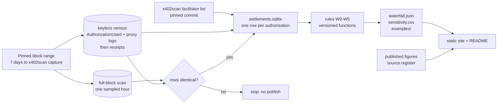
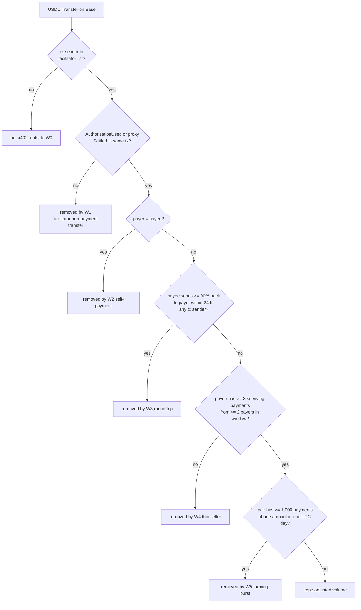
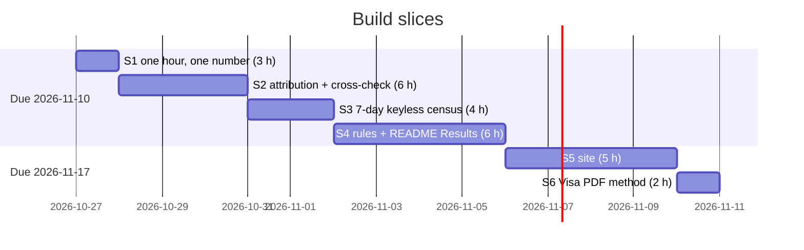

# x402 ground truth: evidence, reasoning and diagrams

Part 2 of the PRD; part 1 is [1-product.md](1-product.md).

## 8. Facts this rests on

| Fact | Source | Used for |
| --- | --- | --- |
| x402 "exact" on EVM settles through EIP-3009 `transferWithAuthorization`, a Permit2 proxy or ERC-7710. The facilitator submits and pays gas. | B2 | W1's marker list. ERC-7710 is counted in slice 2 and noted if nonzero. |
| The deployed proxies emit `Settled()` / `SettledWithPermit()`, not the spec's `x402PermitTransfer`. Base addresses: exact `0x402085c248EeA27D92E8b30b2C58ed07f9E20001`, upto `0x4020A4f3b7b90ccA423B9fabCc0CE57C6C240002`, batch settlement `0x4020074e9dF2ce1deE5A9C1b5c3f541D02a10003`. Over about 22 hours they logged 5, 4,495 and 617 events. | R1 | W1 counts all three as x402 settlement, shown as separate scheme rows. Removing them as non-payments was the draft's largest error. |
| EIP-3009 emits `AuthorizationUsed` plus `Transfer`; any EIP-3009 user emits it, not only x402. | B3, B7, B8 | Settlement = `AuthorizationUsed` in a facilitator-sent transaction, not every `AuthorizationUsed`. |
| v2 adds `upto` and `batch-settlement`, so one transaction can carry several payments. | B5 | Count payments per authorization, not per transaction (AC-11). |
| Base USDC is `0x833589fCD6eDb6E08f4c7C32D4f71b54bdA02913`, 6 decimals. Not yet checked against Circle's docs. | B6 | Slice 1 confirms it by reading `decimals()` and `symbol()` from the contract. |
| x402scan counts every USDC `Transfer` in a transaction whose sender is a synced listed facilitator address, x402 marker or not, after merging pass-through chains inside a transaction into one row (its issue #1024). Since 2026-06-09 its Base data comes from Bitquery; the CDP syncer is disabled. Main was at commit `5732bb83` on 2026-10-27. | C5, C6, C7, R4, O5, O6, O7 | W0 reproduces the filter. A CDP-versus-Bitquery row difference is a reconciliation item, not a replication failure. |
| x402scan's API costs $0.01 per call and offers only rolling 1, 7, 14 and 30-day lookbacks from now, with no per-UTC-day history. | R2 | AC-4 compares against a rolling 7-day figure captured from the free web page, with its timestamp. The paid API is not used. |
| x402scan's facilitator registry lists 30 facilitators with Base addresses: Coinbase 40 (22 deprecated), PayAI 15. | C2, C3, C4 | The attribution list, pinned at one x402scan commit. |
| Visa/Artemis ("Agentic Payments from the Ground Up", July 2026, data to 2026-04-21): raw about $135.7M and 178.3M transactions, adjusted about $15.0M and 109.6M. The "$19M" figure appears in one article only. | A1, A2, D2 | The reconciliation table. Quote $15.0M, dated, not $19M. |
| The Visa/Artemis seller rule as relayed: a seller needs at least 3 adjusted transactions from at least 2 buyers. Not read in the PDF yet. | D3, D1 | Rule W4, marked "as relayed" until slice 6 reads the PDF. |
| Artemis posted a 30-day adjusted figure of $1.6M from a filter for wallets paying themselves or cycling funds. Snippet only. | D5 | A reconciliation row, marked low confidence. Motivates W2 and W3. |
| A Coinbase employee said 25–30% of x402 transactions may come from leaderboard farming. | D6 | W5's expected size. If W5 removes under 5% of payments, the table says so. |
| Jan Curn cited about $1M (x402) and about $1,500 (MPP) over 30 days to mid-October, from x402scan and MPPscan, probably all chains. | E1, E5 | A reconciliation row marked "all chains; not comparable as a Base figure". |
| BeInCrypto's 6.4M payments and $119,947 cover Jul 23 to Aug 26 and are about 94.5% Solana. | E4, E5 | A reconciliation row marked "not comparable: mostly Solana". |
| `base-rpc.publicnode.com` answers `eth_getLogs` keyless, capped at 20,000 results per call; `mainnet.base.org` was rate-limited; Blockscout returned a Cloudflare 403. | G1, G2, G4 | The keyless path for slice 1 and the hourly cross-check. |
| USDC `AuthorizationUsed` on Base ran at about 1,860 to 6,721 per 1,000 blocks in three samples (all callers). | G6 | Sizing: one hour (1,800 blocks) is about 3,000 to 12,000 receipts, feasible keyless. |
| CDP SQL API and BigQuery's public Base dataset are census options that need an account. All-caller USDC `AuthorizationUsed` is at most about 290k a day (G6), so a 7-day keyless pull is at most about 2M logs, about 100 `eth_getLogs` calls under the 20,000-result cap. | G7, G6, G2, R8 | Slice 3 runs keyless overnight. A key is a speed-up only. |
| MPP settles as TIP-20 transfers on Tempo (chain 4217, keyless RPC); MPPscan's code is not public; the event ABI is unconfirmed. | F1, F2, F5, F7 | Why MPP is first on the cut list. |

## 9. Reasoning

**The question.** How much of the x402 volume on Base in one 7-day window is payment for a service, and how much is dust, self-dealing, round trips or test traffic? The analyst acts on the answer by choosing which number to quote.

**Why this shape.**
- *Another live dashboard.* Rejected: x402scan exists and the disagreement is about definitions, not freshness.
- *A blog post comparing the published figures.* Rejected: without a rerunnable filter it adds a fifth opinion.
- *Extend `x402-exception-desk` with real incidents.* Rejected for now: it needs the settlement table this project builds, so it comes after.
- *Chosen:* one pinned window, a waterfall of named rules, each a function with its own count and examples.

**What would make it wrong.** Decided before slice 1 runs:
- If the rules together remove less than 5% of raw volume, the "wash traffic" story is wrong, and the headline says so.
- If the share of W0 dollars kept lands within 5 percentage points of Visa/Artemis's relayed share (about 11% of dollars kept, D3), the headline is "the published adjusted share holds on a later window", labelled as a different window, and the project's value is the rerunnable method. D5 is not a falsifier: it is a snippet from a different month.
- If W0 differs from the captured x402scan 7-day figure by more than 5% after the hour cross-check's coverage correction, the replication is wrong: rule results are then reported only as shares, and the README says so.
- Dust is reported, not excluded. x402 exists for sub-cent payments, so "under 1 cent" (E4) describes the product, not fake traffic.

**Rule definitions (v1).** Each removes payments that survive the rules before it.
- W0: every USDC `Transfer` in a transaction sent by a synced listed facilitator address, with x402scan's pass-through collapse applied (x402scan's filter; `ground_truth/x402scan_filter.py`). W1 then works on every leg, and the waterfall adds the merged legs back as its own step.
- W1: keep transfers in a transaction that carries an EIP-3009 `AuthorizationUsed` whose authorizer is the transfer's sender, or a `Settled`/`SettledWithPermit` log from one of the three proxies.
- W2: remove payer = payee.
- W3: remove a payment when the payee sends at least 90% of it back to the payer within 24 hours, in any transaction (second log query).
- W4: remove payments to a payee with fewer than 3 payments from fewer than 2 distinct payers among the payments surviving W1–W3 in the window. Visa/Artemis apply a similar rule over a lifetime (D3); a lifetime row is added only if slice 6 confirms their wording.
- W5: remove a payer–payee pair's payments on a UTC day when the pair made at least 1,000 payments of one identical amount that day.
- Dust (under $0.01) is reported for each rule, never removed.

## 10. Diagrams

**Data flow.** Read left to right: every published number comes from one pinned block range and one pinned facilitator list, and the RPC path checks the warehouse path on one hour.

**Classification of one USDC transfer.** Each transfer leaves the waterfall at the first rule it fails; the order is fixed so each bar means one thing.

**Build sequence.** Slices run in order, in hours against about 20 hours to 2026-11-10; the Cantina week (to 2026-11-03) is the thin part.

